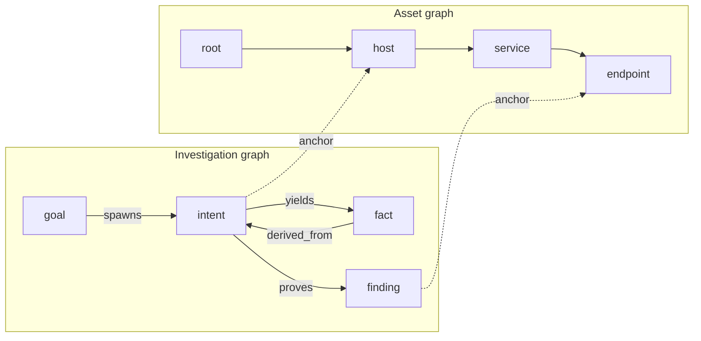

# Asset and Investigation Graphs - Plan

## Goal Capsule

**Objective:** After a mission, an operator can tell which scope names were investigated and which were not, which intent proved a finding, and can trust "verified" only when the finding's quote appears inside that finding's captured tool output. A checklist rejects a claim that lacks scope, impact, reproducibility, evidence, or PII hygiene.

**Means:** In-process asset ledger, investigation lineage, coverage read model, and a quote check composed with the live evidence gate (KTD1, KTD3).

**Authority:** Scope and governance outrank coverage completeness. An out-of-scope write fails. This work does not add attack procedures.

**Stop:** Stop if making `verified` require a quote would need a silent rewrite of stored findings, or if the only way to satisfy a requirement is to import hunt-skill text or a scanner image.

**Execution:** Prove each new module with failing tests first, then implement. Ship on this branch; merge stays with the operator.

## Product Contract

### Summary

BlueHat gains six defensive patterns: an asset graph, an investigation graph, anchors, a coverage ledger, a verbatim quote rule, and a defender checklist. They land in the existing TypeScript platform. Hunt payloads, enterprise attack chains, and the ARTEX scanner image stay out.

### Problem Frame

Operators already store findings and tool evidence, and the live gate already refuses prose-only verification. They still cannot see which in-scope assets nobody investigated, or which fact proved a finding. "Verified" can pass on any non-empty tool blob, with no requirement that a quoted span actually occurs in that blob. Triage questions live in people's heads.

### Key Decisions

- **Assimilate the six defensive patterns into this platform.** (session-settled: user-approved — chosen over vendoring Claude-BugHunter hunt skills and the ARTEX scanner image: the user asked to integrate everything of value after that boundary was shown.) Governs R1, R2, R3, R4, R5.

### Requirements

- R1. For a mission, every name on the mission scope list is reported as tested or untested, including names that were never submitted to the ledger.
- R2. An investigation records goal, intent, fact, and finding, with lineage edges and anchors onto assets.
- R3. A finding becomes verified only when tool-provenance already passes and a caller-supplied quote is a verbatim substring of that tool evidence.
- R4. A defender checklist returns an independent pass or fail for scope, accepted impact, reproducibility, evidence presence, and PII exposure, and it does not execute an attack.
- R5. A write that names an out-of-scope target is rejected and stores nothing.

### Scope Boundaries

In scope: the five requirements, in-memory stores, pure functions, and tests.

Out of scope: copying `hunt-*` skills, payload or bypass tables, CVE exploit chains, a recording proxy, traffic replay, nuclei, sqlmap, or any other scanner image. Replacing `src/recon/attack-graph.ts`, the `Target` model, SCP, or HITL.

### Deferred to Follow-Up Work

- Force-directed coverage UI in the War Room.
- Unifying core `Finding` with the server `FindingRecord`.
- Extracting the evidence routes out of `src/server.ts`.
- Task and intent token budgets, a noise governor, and multi-provider worker rotation.
- Investigation hint nodes.

### Acceptance Examples

- AE1. Scope lists `app.example` and `other.example`. Only `app.example` is in the ledger and anchored. The report marks `app.example` tested and `other.example` untested. An attempt to insert `evil.example` stores nothing. Covers R1, R5.
- AE2. A chain goal spawns intent, intent yields fact, fact derives a second intent, that intent proves a finding, and the finding anchors to the asset the first intent touched. Covers R2.
- AE3. Evidence content `hello marker-alpha world` verifies with quote `marker-alpha` and refuses quote `marker-beta`. Covers R3.
- AE4. A checklist over a finding with no tool evidence fails the evidence question and returns without invoking a tool. Covers R4.

### Sources

- ARTEX README dual graph, anchors, coverage ledger, and the rule that verified requires a bound proof plus a verbatim quote. https://github.com/BaaRai/ARTEX
- Claude-BugHunter README 7-Question Gate (scope and accepted impact called out as Q3 and Q2) and evidence-hygiene gap. https://github.com/elementalsouls/Claude-BugHunter
- Local patterns: `src/evidence/gate.ts` (`gateLiveFinding`), `src/recon/attack-graph.ts` (separate visual scaffold), `src/mission/adjudicate.ts` (`guardExistsInSource`, source-code matching, not evidence matching), `src/governance/scope-match.ts`.
- `docs/solutions/` does not exist. No institutional learning covered this topic.

## Planning Contract

### Key Technical Decisions

- KTD1. Add new in-process modules in this repo. Do not vendor either upstream tree and do not port the Go engine. (session-settled: user-approved — chosen over vendoring those repositories: value has to land in BlueHat.)
- KTD2. Leave `src/recon/attack-graph.ts` and `Target` in place. The asset graph is a containment ledger (root, host, service, endpoint). The attack graph remains a visual kill-chain scaffold with different node kinds. Research showed they are different contracts; replacing the scaffold would break the War Room renderer for no coverage benefit.
- KTD3. Compose a quote check onto the live honesty spine, the same place `recordFinding` calls `gateLiveFinding`. Provenance still runs first. A quote is a required argument on that call. Verification fails when the quote is missing, shorter than 8 characters, or not a raw substring of tool-evidence `content` attached to that finding. Do not reuse `guardExistsInSource`. Do not leave `recordFinding` provenance-only. `verifyFinding` takes the same quote argument and uses the same check. Existing stored findings are not rewritten.
- KTD4. Checklist wording is original defender prose. Credit Sachin Sharma / Claude-BugHunter (CC BY 4.0) for the gate idea in `docs/governance/defender-triage.md`. Do not copy skill files.
- KTD5. The agent surface for this change is the pure functions, called in-process. Do not add an HTTP route, an MCP tool, or an arsenal tool. War Room controls and graph layout stay deferred. HITL approval of an active response stays human-only. Scope rejection and quote failure are the same functions a human caller would hit.

### Assumptions

- No new War Room graph view in this change. Coverage and lineage are returned by pure functions the server can call later.
- Core `Finding` and server `FindingRecord` stay separate. Graphs store string ids.
- Stores are in-memory, same posture as the evidence vault's process lifetime. Disk persistence is deferred.
- The checklist's five questions are the defender set: in scope, accepted impact, reproducible from the attached evidence, tool evidence present, no unredacted PII marker in evidence content. That is the whole rubric for R4.

### High-Level Technical Design



Verification order for a finding: provenance gate, then quote substring against that finding's own tool evidence. The checklist is a separate call. Verified does not imply the checklist passed. Coverage walks the mission scope list. A scope name is tested when an intent, fact, or finding anchor cites a ledger node for that name. Every other scope name is untested, including names with no ledger node. An anchor that cites a missing asset fails the coverage report. Assets outside the mission scope never enter the ledger.

### Output Structure

```text
src/asset-graph/index.ts
src/asset-graph/types.ts
src/investigation/index.ts
src/investigation/types.ts
src/coverage/index.ts
src/evidence/quote-gate.ts
src/governance/defender-triage.ts
src/__tests__/asset-graph.test.ts
src/__tests__/investigation-graph.test.ts
src/__tests__/coverage-ledger.test.ts
src/__tests__/quote-gate.test.ts
src/__tests__/defender-triage.test.ts
docs/governance/defender-triage.md
```

### Risks & Dependencies

- `recordFinding` and `src/__tests__/spine-live.test.ts` currently treat tool evidence alone as verified. U4 adds a required quote on that path and updates the spine test. Do not add a flag that skips the quote. Do not weaken R3 to keep the old test green.
- A quote that is a very short common token can false-pass. Reject quotes shorter than 8 characters.
- PII detection is a marker heuristic (cookie, authorization, bearer, pem). It will miss novel secrets and can flag the word "bearer" in a writeup. Document that limit in the triage doc. It is a gate, not a redaction engine. `src/redact.ts` remains the redaction path.

### System-Wide Impact

Per KTD5, operators and tests call the same pure functions. No new route is added to `src/server.ts`. A scope rejection stores no node. A quote failure does not set verified. Existing approval endpoints stay the human gate for active response. Graph layout is not an agent action.

## Implementation Units

### U1. Asset graph ledger

**Goal:** Record root, host, service, and endpoint nodes with program-owned dedupe.

**Requirements:** R1, R5

**Dependencies:** none

**Files:** `src/asset-graph/types.ts`, `src/asset-graph/index.ts`, `src/__tests__/asset-graph.test.ts`

**Approach:**

1. Node kinds are root, host, service, endpoint. Parent links follow that order only.
2. Dedupe key is kind plus normalized name plus parent id. A second submit of the same key returns the existing id.
3. `submit` accepts raw observations. The module computes the key. Callers do not choose ids.
4. Before insert, run the scope matcher on every host, service, and endpoint name. Root nodes are not targets. Out of scope throws and leaves the store unchanged.
5. Do not import `Target` or attack-graph types.

**Patterns to follow:** `src/evidence/index.ts` in-memory store. `src/governance/scope-match.ts` for the scope question.

**Test scenarios:**

- Submit host `App.Example` twice under the same root and get one node.
- Submit an endpoint whose parent service does not exist and get a rejection with an empty store.
- Submit host `evil.example` when scope is `app.example` and get a rejection with an empty store.
- Submit endpoint `app.example/health` under an in-scope host and get a child whose parent id is that host.
- Submit service `evil.example` under an in-scope host and get a rejection. The store is unchanged.

**Verification:** The four scenarios pass, and no attack-graph type is imported by `src/asset-graph/`.

### U2. Investigation graph and anchors

**Goal:** Record lineage and point intents and findings at assets.

**Requirements:** R2

**Dependencies:** U1

**Files:** `src/investigation/types.ts`, `src/investigation/index.ts`, `src/__tests__/investigation-graph.test.ts`

**Approach:**

1. Node kinds: goal, intent, fact, finding. Hint nodes are deferred.
2. Edge kinds: spawns, yields, derived_from, proves. Reject an edge whose endpoints are missing or whose kind is illegal for the pair (only intent yields fact, only intent proves finding, only goal spawns intent, derived_from links a fact to a later intent).
3. An anchor is a pair of investigation node id and asset id. Anchors are allowed on intent, fact, and finding. Anchoring a missing asset or a goal node fails.
4. The store does not create findings in the evidence vault. It stores the finding id string the caller already has.

**Patterns to follow:** edge validation style in `src/recon/attack-graph.ts` (`validate` helpers), without reusing its node kinds.

**Test scenarios:**

- Build the AE2 chain and read it back as those four edges.
- Add `proves` from a fact to a finding and get a rejection. The edge is not stored.
- Anchor an intent to an unknown asset id and get a rejection.
- Anchor a finding id to an endpoint created in U1 and read that pair back.

**Verification:** Illegal edges and dangling anchors are absent from the store after the rejection.

### U3. Coverage ledger

**Goal:** Report each in-scope asset as tested or untested from anchors.

**Requirements:** R1

**Dependencies:** U1, U2

**Files:** `src/coverage/index.ts`, `src/__tests__/coverage-ledger.test.ts`

**Approach:**

1. Input is the asset store, the anchor list, and the mission scope list. The scope list is the denominator (R1).
2. A scope name is tested when an intent, fact, or finding anchor cites a ledger node whose name is that scope name. Every other scope name is untested, even when the ledger has no node for it.
3. An anchor that cites an asset id missing from the store fails the report. Do not drop it.
4. Return counts plus one row per scope name. Do not return graph coordinates.

**Patterns to follow:** pure scoring in `src/mission/recovery.ts` (`scoreExposure` returns a result object, no I/O).

**Test scenarios:**

- Scope is `app.example` and `other.example`. Only `app.example` is ledgered and anchored. The report marks `app.example` tested and `other.example` untested. Counts are 1 and 1.
- An empty anchor list marks every scope name untested, including a name with no ledger node.
- An anchor whose asset id is unknown fails the report and returns no tested count.

**Verification:** Counts match the per-asset list. No coordinate or layout field exists on the result. A test imports `src/coverage/index.ts` without starting the server (KTD5).

### U4. Verbatim quote gate

**Goal:** Block verification unless the quote sits inside tool evidence.

**Requirements:** R3

**Dependencies:** none

**Files:** `src/evidence/quote-gate.ts`, `src/evidence/index.ts`, `src/operators/index.ts`, `src/__tests__/quote-gate.test.ts`, `src/__tests__/spine-live.test.ts`

**Approach:**

1. Add a pure quote check over the evidence items attached to that finding whose type is output, command, response, request, log, or file. Screenshot and other types do not count.
2. Pass only when the quote length is at least 8 and `content.includes(quote)` is true for one of those items (KTD3).
3. `recordFinding` calls `gateLiveFinding` first. If that passes, it calls the quote check with a required quote argument. Missing or short quote fails and does not set verified. `verifyFinding` takes the same quote argument and uses the same check.
4. Do not rewrite findings the caller did not just verify.

**Execution note:** Add the failing spine-live case before changing `recordFinding`, so today's tool-only verify is visible when it breaks.

**Patterns to follow:** `src/evidence/gate.ts` reason strings. Substring presence only, unlike `guardExistsInSource`.

**Test scenarios:**

- Content `hello marker-alpha world` and quote `marker-alpha` passes.
- The same content and quote `marker-beta` fails and does not set verified.
- Quote `short` (5 characters) fails even when the content contains it.
- A screenshot whose content contains the quote fails when no tool-typed evidence contains it.
- Empty quote fails with a missing-quote reason.
- Provenance failure still fails when a valid quote is present and no tool evidence exists.

**Verification:** `gateLiveFinding` still answers provenance only. `recordFinding` without a quote of at least 8 characters does not set verified. The spine-live test covers that case.

### U5. Defender triage checklist

**Goal:** Score the five questions without running a tool.

**Requirements:** R4

**Dependencies:** U4

**Files:** `src/governance/defender-triage.ts`, `src/__tests__/defender-triage.test.ts`, `docs/governance/defender-triage.md`

**Approach:**

1. Input is the finding, its evidence, a scope list, the finding's target name, and a boolean `impactAccepted`. `impactAccepted` stays a caller assertion because accepting impact is a human judgment (KTD5). Scope and reproducibility are computed, not trusted flags.
2. Questions: in scope (scope matcher on the target name), impact accepted, reproducible (this module calls the quote check), tool evidence present, PII clear.
3. PII clear fails when any tool-evidence content on that finding matches `cookie:`, `authorization:`, `bearer `, or `-----BEGIN`. Scan the same evidence types the quote gate scans. A marker in a second item fails the question.
4. The function returns five results and an overall pass that is true only when all five pass. It has no tool parameter and does not import the arsenal.
5. The doc states the CC BY 4.0 credit, the marker limit, and that this is not the BugHunter skill text.

**Patterns to follow:** `src/evidence/gate.ts` pure result object.

**Test scenarios:**

- All inputs good, quote gate passed, no marker: overall pass, five passes.
- A finding whose target is `evil.example` against scope `app.example` fails the scope question.
- A finding with zero tool-evidence items fails the evidence question and the call runs no tool. Covers AE4.
- Calling the function does not require an arsenal or server. The test imports only the checklist module.

**Verification:** The doc contains the credit line and the marker limitation. The test file does not import `src/arsenal/`.

## Verification Contract

Prove the change with the new vitest files named on U1 through U5, then `npm run lint`, `npm run typecheck`, and `npm test` from the repo root. `npm run test:pr` remains the pull-request gate and includes those plus `npm run doctor`. A green quote-gate test that accepts a missing quote does not count. A triage test that shells out does not count.

## Definition of Done

- R1 through R5 hold under the tests named above.
- U1 through U5 are present. Abandoned experiments are not in the diff.
- `src/asset-graph/` does not import the attack graph. `src/governance/defender-triage.ts` does not import the arsenal.
- `docs/governance/defender-triage.md` carries the CC BY credit and the marker limitation.
- No hunt-skill markdown, payload table, or scanner install is added.
