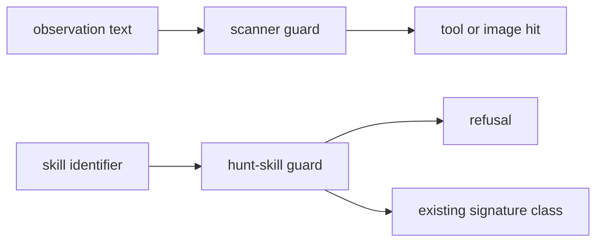

# Scanner and Hunt Guard - Plan

## Goal Capsule

**Objective:** An operator can tell when an observation is the ARTEX scanner image or one of its bundled scanner tools, and a hunt-skill identifier is refused instead of loaded. Existing payload detection stays the detector for those classes.

**Means:** Two pure classifiers beside the detection engine (KTD1, KTD2).

**Authority:** Do not add attack strings, skill bodies, or a scanner image. A match is an alert or a refusal, not a launch.

**Stop:** Stop if the only way to name a class is to paste an exploit string or a scanner command line.

**Execution:** Tests first on identifiers. Ship stays blocked while the checkout is the upstream-sync branch.

## Product Contract

### Summary

BlueHat grows a guard for three things it previously left outside: hunt-skill identifiers, the payload classes those skills hunt, and the ARTEX scanner image. The guard recognizes tool and image names and refuses hunt-skill loads. It does not import the skills, the payload tables, or the image.

### Problem Frame

The detection engine already matches a fixed payload corpus. It does not recognize the scanner image or the tool names that image ships, and nothing refuses a hunt-skill bundle by name. Copying those bundles in would make BlueHat the attacker.

### Key Decisions

- **Protect by recognition and refusal.** (session-settled: user-directed — chosen over importing Hunt skills, payload tables, and the ARTEX scanner image: the request is to protect against them.) Governs R1, R2, R3.

### Requirements

- R1. An observation that names the ARTEX image or a bundled scanner tool is reported as that scanner, with the tool or image name.
- R2. A skill identifier that is a hunt skill or the Claude-BugHunter bundle is refused, and the refusal names the matched token.
- R3. Hunt classes that already have signature categories are reported as covered by those categories. No new payload string is added.

### Scope Boundaries

In scope: the three requirements, pure functions, and tests that use tool names, image references, and skill ids.

Out of scope: hunt-skill markdown, payload or bypass tables, scanner command lines, pulling or running the image, and a War Room panel.

### Deferred to Follow-Up Work

- Wiring the guard into every live request path in `src/server.ts`.
- Moving `src/coverage/` out of the gitignored `coverage/` tree so the earlier ledger is committable.

### Acceptance Examples

- AE1. Text `ghcr.io/baarai/artex` reports an image hit named `ghcr.io/baarai/artex`. Text `nuclei` reports a tool hit named `nuclei`. Text `ordinary browser` reports no hit. Covers R1.
- AE2. Identifier `hunt-ssrf` is refused. Identifier `web-recon` is allowed. Covers R2.
- AE3. Class `xss` is covered. Class `not-a-class` is not covered. The payload module's export list is unchanged. Covers R3.

### Sources

- ARTEX README lists the image toolchain as nmap, nuclei, httpx, katana, ffuf, dalfox, and sqlmap, and the image name `ghcr.io/baarai/artex`. https://github.com/BaaRai/ARTEX
- Claude-BugHunter README names `hunt-*` skills. https://github.com/elementalsouls/Claude-BugHunter
- Local detectors: `src/detection/signatures.ts` and `src/detection/payloads.ts`. Those files stay the payload corpus.

## Planning Contract

### Key Technical Decisions

- KTD1. Match scanner identity with whole-word tool names and the image reference substring. Do not match flags, scripts, or request bodies. (session-settled: user-directed — chosen over shipping the scanner image: protection is recognition.)
- KTD2. Refuse a skill load from the identifier alone. Map a hunt suffix onto the existing signature category when one exists. Do not read skill files.
- KTD3. Leave `src/detection/payloads.ts` byte-for-byte unchanged in this change.

### Assumptions

- Tool names are the public binary names from the ARTEX README. User-Agent strings that contain those names as whole words count.
- `server.ts` is not edited. Callers can use the functions directly.
- The earlier asset-graph work stays uncommitted on this branch and is not part of this change.

### High-Level Technical Design

### Risks & Dependencies

- Whole-word `httpx` or `nmap` can match a person writing about the tool. That is an alert, not a block of the sentence. Image hits require the registry path `ghcr.io/baarai/artex`.
- A renamed hunt skill that drops the `hunt-` prefix will not be refused. The refusal is identifier-based.

## Implementation Units

### U1. Scanner identity guard

**Goal:** Report ARTEX image and bundled tool names.

**Requirements:** R1

**Dependencies:** none

**Files:** `src/detection/scanner-guard.ts`, `src/__tests__/scanner-guard.test.ts`

**Approach:**

1. Tools are nmap, nuclei, httpx, katana, ffuf, dalfox, sqlmap. Match a whole word, case-insensitive.
2. The image match is the substring `ghcr.io/baarai/artex`.
3. Return a list of hits. No hit returns an empty list.
4. Do not import `src/detection/payloads.ts`.

**Test scenarios:**

- `ghcr.io/baarai/artex` returns one image hit with that name.
- `started nuclei against the range` returns a tool hit named `nuclei`.
- `ordinary browser` returns an empty list.
- `httpx` inside `nothttpxtool` does not match.

**Verification:** The four cases pass, and the module source does not contain a flag or a URL path beyond the image reference.

### U2. Hunt-skill refusal and class coverage

**Goal:** Refuse hunt-skill identifiers and point known classes at existing detectors.

**Requirements:** R2, R3

**Dependencies:** none

**Files:** `src/detection/hunt-skill-guard.ts`, `src/__tests__/hunt-skill-guard.test.ts`

**Approach:**

1. Refuse when the identifier matches `hunt-` plus a slug, or contains `claude-bughunter`.
2. Covered classes are xss, sqli, ssrf, lfi, ssti, xxe, cmdi. Those names are the existing signature categories.
3. A refused `hunt-xss` also reports covered. A refused `hunt-oauth` reports not covered. An allowed id reports allowed and not covered.
4. Do not read or embed skill text. Do not edit `src/detection/payloads.ts`.

**Test scenarios:**

- `hunt-ssrf` is refused and covered.
- `skills/hunt-oauth/SKILL.md` is refused and not covered.
- `claude-bughunter:hunt-xss` is refused and covered.
- `web-recon` is allowed.
- `not-a-class` is not covered.

**Verification:** Tests pass. `git diff -- src/detection/payloads.ts` is empty.

## Verification Contract

Run the two new vitest files. Then `npx eslint` on the new files and `npx tsc --noEmit`. A test that contains an exploit string does not count.

## Definition of Done

- R1 through R3 hold under those tests.
- `src/detection/payloads.ts` is unchanged.
- No hunt-skill body, payload table, or scanner image is added.
